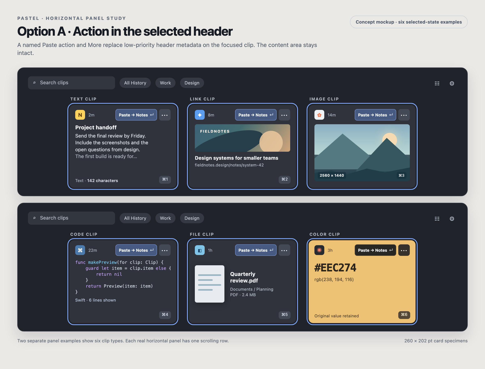
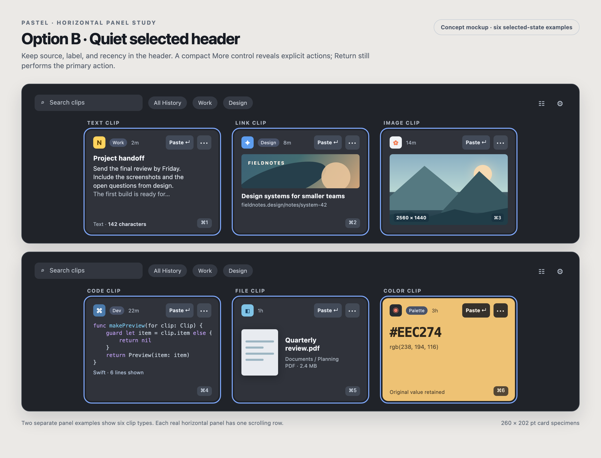

# Horizontal clip card layout review

Reviewed 2026-10-10 against the current SwiftUI source on `ux-learnings`. These are design proposals, not screenshots from a running build. Repository screenshots are older and were used only for context. The two image boards show six *separate selected-card examples* in two one-row horizontal panels; a real panel has one selected clip at a time.

The editable mockup source is [card-layout-options.html](card-layout-options.html). Option A is recommended.

## Current spatial contract and findings

The horizontal panel is 270 pt high and cards are 260 pt wide. `PanelContentView` always appends the full-width action strip after the card list. `ClipboardCardView` places source icon, as many as three label chips, pin state, and recency in its header. Its footer appears whenever an item has a title **or a numbered shortcut badge**; numbered badges are present on the first nine panel cards, so the footer is effectively always reserved. In horizontal mode a `Spacer` pushes it to the bottom. This explains the simultaneous crowding of rich clips and empty middle space on short text or file clips. Uniform card slots help scanning; the extra footer row and panel-wide action strip are the avoidable costs.

| Clip type | Current use of space | Recommended horizontal-strip treatment |
| --- | --- | --- |
| Text and rich text | Four versus eight preview lines by orientation; the footer title sits below content, separated by a flexible gap. | Put a user title immediately before the excerpt. Keep a readable excerpt and use Space for the full content. Leave genuine blank space on short clips rather than filling it with metadata. |
| Link | A 106 pt media well is reserved even for a favicon-size preview, then page title and URL compete with the common footer. | Cap a real banner near 64–72 pt in this compact context. For favicon-only or no media, omit the large well and put the icon beside the title. Keep the distinguishable URL suffix visible with middle truncation. |
| Image | Image preview caps at 120 pt even when the slot has room. | Let an image fit the space left below the header, retaining its full aspect ratio. Keep dimensions as a small opaque corner label; never crop the copied image just to fill a rectangle. |
| Code | Up to ten lines plus a separate language badge and possible common title footer. | Give code the remaining content height and truncate deliberately. Keep the language as compact secondary metadata. Space shows the full selectable code. |
| File | Generic document symbol, filename, and one-line full path repeat information and leave much of the slot unused. | When cheaply available, show a bounded system thumbnail beside the filename. Show parent folder and file kind/size, with the full path in preview or Help. Preserve a truthful unavailable state. |
| Color | The actual color rightly fills the card, but all text and controls sit on arbitrary user color. | Keep the swatch faithful. Use an opaque neutral action control and a calculated high-contrast foreground for value and metadata. |

These refinements should be **panel-strip-specific**. `ClipboardCardView` currently reads the global `panelEdge` preference and also appears in History, a coupling also identified in the supplied `docs/UI_UX_IMPROVEMENT_PLAN.md`. Pass an explicit presentation context before changing card geometry, so the History grid does not change when someone moves the quick panel. Retain its richer media treatment and current footer until the History design is separately reviewed.

## Option A: named action in the selected card header (recommended)

The selected card uses its existing header row for the source icon, compact recency, a real **Paste → Notes ↵** or **Copy ↵** button, and a More menu. Selection does not change card height or move its content. On selected cards, label chips and the pin glyph yield to the action; their values remain available in the More menu, preview, and accessibility description. Unselected cards retain metadata. The numbered shortcut becomes a small backed badge at the bottom corner without allocating a separate footer row. A user-authored title moves next to the content it names.

This keeps the consequence visible at the point of selection and reclaims the panel-wide strip. It follows Apple's guidance to group related controls with content (`layout.md › Visual hierarchy`) and to label buttons by their effect (`buttons.md › Content`). The 28 pt control targets in the mockup are design starting points, not a claim of tested hit bounds.

At 260 pt, long destination names need bounded truncation; the action verb must remain visible, and Help/VoiceOver should expose the full destination. If the selected range contains several clips, the header action must name the aggregate and any partial text operation (`Paste 2 of 3 as Text`), or a temporary selection-level control must appear. It must never imply that the focused card alone will be pasted when the action acts on the whole range.

## Option B: quieter selected card header

Keep source, one label, and recency in the selected header, alongside compact **Paste ↵** and More controls. This makes label context easier to see and works with longer or more numerous labels, but the destination is no longer immediately visible. The full `Paste into Notes` or Copy outcome must be shown in the menu and accessible label. This is a sensible density fallback if testing finds Option A too busy, but it gives up part of the clarity gained by the current named footer.

Both options remove the horizontal panel's persistent action strip. The vertical panel can retain its existing action bar because its geometry and browsing pattern differ. The More control should use the existing Actions commands and Command-K; on-card buttons need distinct focus and VoiceOver elements rather than being absorbed by the card's current combined accessibility element. Clicking an action must execute it for the selected item or selected range exactly once, without also triggering the card's single/double-click gestures. Keep More keyboard-accessible when pointer hover is unavailable.

## Related findings from the broader UI/UX plan

The supplied UI/UX improvement plan identifies a confirmed color contrast problem. `contrastingColor(forHex:)` uses unlinearized channel weights and a fixed cutoff. For `#FF0000`, it chooses white text with 4.00:1 contrast although black would provide 5.25:1. Correct this before adding controls to arbitrary swatches; check secondary text, labels, and shortcut badges as rendered, not just the large hex value (`accessibility.md › Vision`, `color.md › Inclusive color`).

The plan also recommends explicit presentation contexts, larger control targets, text enlargement, and reduced-motion checks. Those remain relevant here. Its suggestion to keep a stable action footer should apply to surfaces where the footer earns its area; the reported horizontal quick-panel strip is a strong reason to test an on-card alternative. No claim about the exact current rendered spacing, contrast over glass, or assistive behavior can be made without a current-build inspection.

## Suggested implementation and review order

1. Separate panel-strip versus History card presentation. Preserve the existing ring, source tint, paste routing, and History appearance.
2. Correct color-card contrast and confirm backed action controls remain legible for vivid, dark, and near-white colors.
3. Prototype Option A with real buttons and menu semantics. Remove only the horizontal panel-wide strip, then tune panel height against the tallest link, image, code, and enlarged-text cases.
4. Apply the compact content rules by type, beginning with URL favicon-only states and image sizing. Retain full content through Space preview.
5. Compare A and B in a current build at top and bottom edges, light/dark, busy backdrops, long destination names and labels, keyboard/VoiceOver/Full Keyboard Access, multi-selection, and Copy mode. Verify that selecting or deselecting cards never shifts the content row or causes accidental activation.

Apple's relevant principles are also in [Collections](https://developer.apple.com/design/human-interface-guidelines/collections) (make items easy to choose), [Menus](https://developer.apple.com/design/human-interface-guidelines/menus) (name commands clearly), and [Focus and selection](https://developer.apple.com/design/human-interface-guidelines/focus-and-selection) (keep focus predictable). The two visual treatments and their exact measurements are Pastel design judgments, not prescribed Apple layouts.
