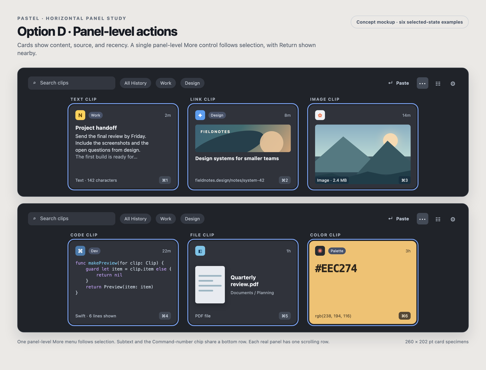
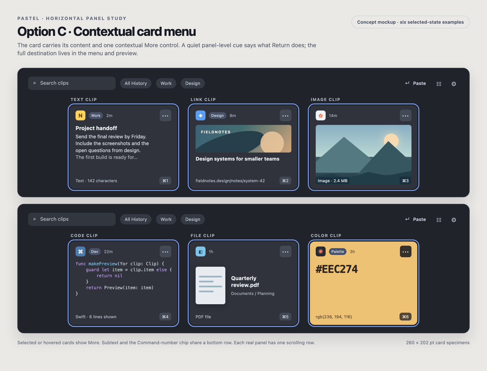

# Horizontal clip card layout review

Reviewed 2026-10-10 against the current SwiftUI source on `ux-learnings`. These are design proposals, not screenshots from a running build. Repository screenshots are older and were used only for context. Each board shows six *separate selected-card examples* in two one-row horizontal panels; a real panel normally has one selected clip at a time.

The editable mockup source is [card-layout-options.html](card-layout-options.html). **Option D is now implemented in source**, with rendered visual and accessibility checks pending. The boards remain illustrative, not captures of the built app. Earlier [Option A](card-layout-option-a.png) and [Option B](card-layout-option-b.png) remain comparison points.

## Decision on action text and the ellipsis

**Paste into Notes** is useful when a person is about to act, but repeating it in a 260 pt card is a poor use of space. **Actions** adds little beside a known menu affordance. Remove both strings from horizontal cards and remove the permanent bottom action strip. A compact, clickable panel-level `↵ Paste` or `↵ Copy` cue should reflect the *actual* default behavior. Its Help, accessibility name, first menu command, and Space preview can give the full `Paste into Notes` or `Copy to Clipboard` outcome. If there is no valid paste target, the cue must say Copy before activation.

Right-click is valuable but invisible to a new user and unavailable in some pointer and assistive workflows. Keep **one visible ellipsis**, preferably in the panel toolbar beside the primary cue, enabled for the current selection. Its menu shares the existing Command-K and context-menu action definitions. This avoids a 28 pt control competing with the source, labels, timestamp, and content on every card. The toolbar button must be keyboard-focusable; VoiceOver should announce “More actions for [selected clip].” Disable it for no-selection or loading states with a clear reason.

If a panel-level menu feels too detached in usability testing, Option C is the fallback: show an ellipsis only on the **focused selected** or hovered card, reserving its header slot so content never jumps. In a multi-selection, the toolbar menu acts on the selection; a card context menu acts on the clicked clip. Do not put a separate ellipsis on every member of a range.

## Current spatial contract and findings

The horizontal panel is 270 pt high and cards are 260 pt wide. `PanelContentView` always appends the full-width action strip after the card list. `ClipboardCardView` places source icon, as many as three label chips, pin state, and recency in its header. Its footer appears whenever an item has a title **or a numbered shortcut badge**; numbered badges are present on the first nine panel cards, so the footer is effectively always reserved. In horizontal mode a `Spacer` pushes it to the bottom. This explains the simultaneous crowding of rich clips and empty middle space on short text or file clips. Uniform card slots help scanning; the separate title footer, flexible spacer, and panel-wide action strip are the avoidable costs.

Removing the bottom strip should also reduce the panel's default height where content allows. Do not exchange a labeled sliver for an unlabeled one. Keep uniform card bounds for scanning, use extra room for bounded image/code previews when useful, and let genuinely short text keep breathing room. A user title belongs beside its excerpt. **Keep the existing Command-1–9 chip persistently visible at bottom right** on the numbered clips. Align useful secondary text on the same baseline at bottom left: `Swift · 6 lines shown`, URL, image dimensions, file kind/size, or color format as appropriate. Reserve that small baseline inside the card so the preview cannot overlap it; a backed overlay is acceptable over image content. A clip without useful subtext can leave the left side empty.

| Clip type | Current use of space | Recommended horizontal-strip treatment |
| --- | --- | --- |
| Text and rich text | Four versus eight preview lines by orientation; the footer title sits below content, separated by a flexible gap. | Put a user title immediately before the excerpt. Keep a readable excerpt and use Space for the full content. Leave genuine blank space on short clips rather than filling it with metadata. |
| Link | A 106 pt media well is reserved even for a favicon-size preview, then page title and URL compete with the common footer. | Cap a real banner near 64–72 pt in this compact context. For favicon-only or no media, omit the large well and put the icon beside the title. Keep the distinguishable URL suffix visible with middle truncation. |
| Image | Image preview caps at 120 pt even when the slot has room. | Let an image fit the space left below the header, retaining its full aspect ratio. Keep dimensions as a small opaque corner label; never crop the copied image just to fill a rectangle. |
| Code | Up to ten lines plus a separate language badge and possible common title footer. | Give code the remaining content height and truncate deliberately. Keep the language as compact secondary metadata. Space shows the full selectable code. |
| File | Generic document symbol, filename, and one-line full path repeat information and leave much of the slot unused. | When cheaply available, show a bounded system thumbnail beside the filename. Show parent folder and file kind/size, with the full path in preview or Help. Preserve a truthful unavailable state. |
| Color | The actual color rightly fills the card, but all text and controls sit on arbitrary user color. | Keep the swatch faithful. Calculate a high-contrast foreground for value and metadata; back any on-card control with an opaque neutral surface. |

These refinements should be **panel-strip-specific**. `ClipboardCardView` currently reads the global `panelEdge` preference and also appears in History, a coupling also identified in the supplied `docs/UI_UX_IMPROVEMENT_PLAN.md`. Pass an explicit presentation context before changing card geometry, so the History grid does not change when someone moves the quick panel. Retain its richer media treatment and current footer until the History design is separately reviewed.

## Option D: one panel-level actions control (recommended)

The card header carries source icon, at most one label plus an overflow count, pin state when relevant, and relative time. The content preview gets the remaining area above the aligned subtext/shortcut baseline. No action phrase or ellipsis sits inside the card. The top region carries a compact, clickable `↵ Paste`/`↵ Copy` primary action and one More button for the current selection. The full destination appears in the menu, Help, accessibility, and Space preview. Keep the selected card's ring clear so the toolbar's target is obvious. Multi-selection needs a visible count and truthful partial-operation wording. If that will not fit in the top row, show a temporary group-action row only while several clips are selected.

The existing top row also holds search, label chips, New Snippet, Pick Colour, panel position, and Settings. Prototype at the narrowest supported width. Collapse rarely used utilities into one menu before allowing chips to crush search or hiding the primary action. Preserve shortcuts and direct access to common functions. The image board simplifies toolbar utilities for legibility; it is a design study, not an exact current-build capture.

## Option C: contextual card-level More

The focused selected or hovered card reveals only More in its header; a separate compact panel cue describes Return. This saves the bottom strip and keeps actions close to content, but link and image cards lose header width. Its button needs a stable hit target, distinct focus state, and routing that cannot also fire the card's single/double-click gestures. Reserve space without drawing the button on unselected cards so content does not move with selection.

## Earlier options A and B

### Option A: named action in the selected card header

The selected card uses its existing header row for the source icon, compact recency, a real **Paste → Notes ↵** or **Copy ↵** button, and a More menu. Selection does not change card height or move its content. On selected cards, label chips and the pin glyph yield to the action; their values remain available in the More menu, preview, and accessibility description. Unselected cards retain metadata. The numbered shortcut becomes a small backed badge at the bottom corner without allocating a separate footer row. A user-authored title moves next to the content it names.

This kept the consequence visible at the point of selection and reclaimed the panel-wide strip, but the primary action and More overwhelmed dense link and image cards. Clear action labels still belong in the menu, Help, accessibility, and preview. The 28 pt control targets in the mockup are design starting points, not a claim of tested hit bounds.

At 260 pt, long destination names need bounded truncation; the action verb must remain visible, and Help/VoiceOver should expose the full destination. If the selected range contains several clips, the header action must name the aggregate and any partial text operation (`Paste 2 of 3 as Text`), or a temporary selection-level control must appear. It must never imply that the focused card alone will be pasted when the action acts on the whole range.

### Option B: quieter selected card header

Keep source, one label, and recency in the selected header, alongside compact **Paste ↵** and More controls. This retains more metadata but still spends two controls on every selected card. Option C and D better fit the content-first direction.

All four options remove the horizontal panel's persistent action strip. The vertical panel can retain its existing action bar because its geometry and browsing pattern differ, subject to its own density review. The More control should use the existing Actions commands and Command-K; any on-card button needs a distinct focus and VoiceOver element rather than being absorbed by the card's current combined accessibility element. Clicking an action must execute exactly once. Keep More keyboard-accessible when pointer hover is unavailable.

## Related findings from the broader UI/UX plan

The supplied UI/UX improvement plan identifies a confirmed color contrast problem. `contrastingColor(forHex:)` uses unlinearized channel weights and a fixed cutoff. For `#FF0000`, it chooses white text with 4.00:1 contrast although black would provide 5.25:1. Correct this before adding controls to arbitrary swatches; check secondary text, labels, and shortcut badges as rendered, not just the large hex value (`accessibility.md › Vision`, `color.md › Inclusive color`).

The plan also recommends explicit presentation contexts, larger control targets, text enlargement, and reduced-motion checks. Those remain relevant here. Its suggestion to keep a stable action footer should apply to surfaces where the footer earns its area; the reported horizontal quick-panel strip is a strong reason to test the toolbar and contextual alternatives. No claim about the exact current rendered spacing, contrast over glass, or assistive behavior can be made without a current-build inspection.

## Recommendations beyond the shortcut chip

| Priority | Area | Change and reason |
| --- | --- | --- |
| First panel pass | Horizontal panel geometry | Remove the persistent bottom action strip and measure a shorter default panel. Preserve the real button semantics of the primary action in the top row. This returns attention and screen area to clips rather than leaving a new empty band. |
| First panel pass | Search, filters, and toolbar | Search must retain a useful width when labels wrap or many controls are present. Show active filters clearly with an easy clear action. Consolidate infrequent utilities before compressing search, primary action, or More. The mockup omits some current utilities; test a real-width build. |
| First panel pass | Action truthfulness | `↵ Paste` changes to `↵ Copy` for copy mode or absent destination. Menu, Help, accessibility, and preview retain the complete destination and explicit Paste/Copy commands. For multiple clips, show selected count and any text-only partial action; no single-card label should imply an operation on the whole range. |
| Next product pass | History as a library | History currently lives inside Settings. A dedicated resizable History workspace with List/Grid choice would make scanning, organizing, and larger previews practical without turning the quick panel into a library window. This is a larger separate change from card density. |
| Cross-cutting | Keyboard and accessibility | Give History full arrows/Return/Space navigation; preserve visible focus independently from selection. Fix arbitrary-color text contrast, verify VoiceOver menu/button names, enlarge hit targets, and check text enlargement and Reduce Motion. These gaps are documented in the supplied UI/UX plan and need live validation. |

## Implementation and review order

1. Separate panel-strip versus History card presentation. Preserve the existing ring, source tint, paste routing, and History appearance.
2. Correct color-card contrast and confirm backed action controls remain legible for vivid, dark, and near-white colors.
3. Prototype Option D with a real primary button and More menu in the panel top row. Remove only the horizontal panel-wide strip, then tune panel height against the tallest link, image, code, and enlarged-text cases. Compare Option C if toolbar crowding or selection association is a problem.
4. Apply the compact content rules by type, beginning with URL favicon-only states and image sizing. Retain full content through Space preview.
5. Compare D and C in a current build at top and bottom edges, light/dark, busy backdrops, long destination names and labels, keyboard/VoiceOver/Full Keyboard Access, multi-selection, and Copy mode. Verify that selecting or deselecting cards never shifts the content row or causes accidental activation. Test whether people find More without first being told about right-click.

Steps 1–4 have an initial source implementation on `ux-learnings`. Both macOS build variants compile; step 5 remains pending because UI inspection timed out. The current card footer shows image byte size and file kind where the earlier concept board used illustrative dimensions and file size.

Apple's relevant principles are also in [Collections](https://developer.apple.com/design/human-interface-guidelines/collections) (make items easy to choose), [Menus](https://developer.apple.com/design/human-interface-guidelines/menus) (name commands clearly), and [Focus and selection](https://developer.apple.com/design/human-interface-guidelines/focus-and-selection) (keep focus predictable). The visual treatments and their exact measurements are Pastel design judgments, not prescribed Apple layouts.
